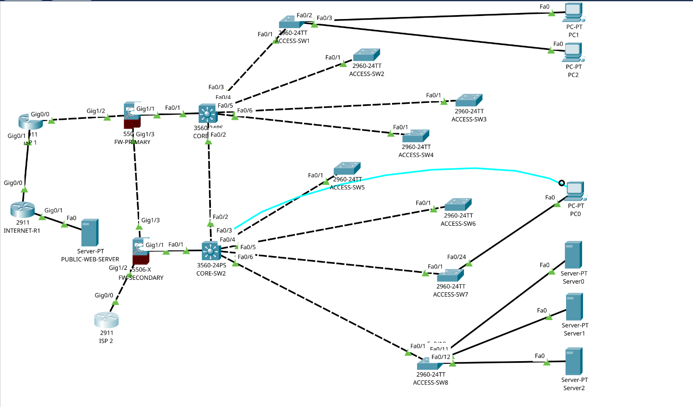

# Enterprise Network Security Lab
# Enterprise Network Security Lab

A simulated enterprise network infrastructure designed and implemented using **Cisco Packet Tracer**. The project demonstrates enterprise network architecture, VLAN segmentation, inter-VLAN routing, network security, firewall configuration, redundancy concepts, Quality of Service (QoS), and connectivity testing.

## Project Overview

This project simulates a corporate network environment consisting of a Head Office (HQ) and a Branch Office supporting approximately 1,500 agents and other business departments.

The design focuses on building a structured, segmented, and secure network that supports internal business applications, centralized services, network administration, and simulated internet connectivity.

## Network Topology

The diagram below represents the actual network topology implemented in Cisco Packet Tracer.

**Insert the actual Packet Tracer topology screenshot below.**



*The topology image is captured directly from the Cisco Packet Tracer project.*

## Network Architecture

The simulated infrastructure includes:

- Two multilayer core switches (CORE-SW1 and CORE-SW2).
- Eight access switches for end-user connectivity.
- Two Cisco ASA firewalls.
- Two ISP routers for WAN connectivity simulation.
- An internet simulation router and public web server.
- DMZ and internal server segments.
- Dedicated VLANs for business departments, agents, IT administration, and network management.

## Technologies and Features

| Technology | Implementation |
|---|---|
| Cisco Packet Tracer | Network design and simulation |
| VLANs | Departmental and functional network segmentation |
| Inter-VLAN Routing | Communication between authorized VLANs |
| HSRP | Default gateway redundancy |
| Cisco ASA | Firewall and access-control configuration |
| ACLs | Traffic filtering and access restrictions |
| NAT/PAT | Address translation for simulated internet access |
| Static Routing | Internal and external route configuration |
| QoS | Voice traffic classification and prioritization |
| SSH | Secure network device administration |
| DNS | Internal name resolution |
| DMZ | Separation of public-facing and internal services |

## VLAN and IP Addressing Plan

The network uses separate VLANs and IP subnets to organize users, services, and infrastructure.

| VLAN | Name | Network |
|---:|---|---|
| 10 | BUSINESS_A | 10.10.10.0/24 |
| 20 | BUSINESS_B | 10.10.20.0/24 |
| 30 | BUSINESS_C | 10.10.30.0/24 |
| 40 | AGENTS | 10.10.40.0/24 |
| 50 | BUSINESS_E | 10.10.50.0/24 |
| 60 | BUSINESS_F | 10.10.60.0/24 |
| 70 | VOICE_QOS | Reserved |
| 80 | WFM_QA | 10.10.80.0/24 |
| 90 | TEAM_MANAGERS | 10.10.90.0/24 |
| 100 | IT_ADMIN | 10.10.100.0/24 |
| 110 | FINANCE_HR | 10.10.110.0/24 |
| 120 | DMZ | 192.168.4.0/25 |
| 130 | INTERNAL_SERVERS | 10.10.130.0/24 |
| 140 | NETWORK_MGMT | 10.10.140.0/24 |

## Core Switch Redundancy

Two multilayer switches provide redundant default gateway functionality through Hot Standby Router Protocol (HSRP).

- CORE-SW1: Priority 110, preferred active gateway.
- CORE-SW2: Priority 100, standby gateway.
- Virtual gateway: Typically `.1` within each configured VLAN subnet.

This design demonstrates how HSRP can help maintain gateway availability when a core switch becomes unavailable.

## Firewall and WAN Design

The network includes two Cisco ASA firewalls connected to separate ISP routers.

The design demonstrates:

- Firewall interfaces and security zones.
- Inside and outside network connectivity.
- Access Control Lists (ACLs).
- NAT/PAT configuration.
- Static routing.
- Separate ISP connectivity paths.

The ISP and internet simulation includes an internet router and a public web server for connectivity testing.

**Implementation note:** The two firewalls are configured independently. A fully operational firewall high-availability pair and automatic ISP failover have not been verified.

## Network Security and Access Control

Security implementation focuses on controlling access between network segments and protecting internal resources.

Implemented security elements include:

- VLAN-based network segmentation.
- Access Control Lists for traffic filtering.
- Restricted network device management through SSH access controls.
- Firewall policies.
- NAT/PAT.
- A dedicated DMZ segment.
- Separation of agent and administrative networks.

The agent VLAN includes access-control rules intended to restrict access to authorized internal applications, including the CRM system. However, complete agent-to-administration isolation remains a work in progress and requires further validation.

## Internal Services

The simulated environment includes internal services hosted within the DMZ and server network.

| Service | IP Address |
|---|---|
| CRM Application | 192.168.4.10 |
| Internal DNS | 192.168.4.11 |
| Web/Mail Test Server | 192.168.4.12 |

Internal DNS supports name resolution for services such as `crm.company.local`.

## Quality of Service (QoS)

QoS configuration demonstrates traffic classification and prioritization for voice-related traffic.

- DSCP EF traffic classification.
- Voice traffic class-map.
- Priority queuing policy.
- QoS policy application on selected network interfaces.

VLAN 70 is reserved for voice-related traffic. Performance under actual network congestion has not been fully benchmarked.

## Testing and Verification

The project includes practical connectivity and configuration checks using Cisco Packet Tracer command-line tools.

Examples include:

```bash
show vlan brief
show interfaces trunk
show standby brief
show ip interface brief
show ip route
show access-lists
show running-config
```

Connectivity testing includes:

- Inter-VLAN communication.
- Gateway reachability.
- HSRP active and standby status.
- Internal DNS resolution.
- CRM application accessibility.
- Firewall and ISP connectivity checks.
- Public web server reachability.

Some connectivity and redundancy scenarios remain under development and are documented accordingly.

## Project Documentation

Detailed technical documentation is available below:

1. [Network Architecture](docs/NETWORK-ARCHITECTURE.md)
2. [Core Switch Configurations](docs/CORE-SWITCH-CONFIGURATIONS.md)
3. [Firewall and WAN Configurations](docs/FIREWALL-AND-WAN-CONFIGURATIONS.md)
4. [ISP and Internet Simulation](docs/ISP-AND-INTERNET-SIMULATION.md)
5. [Network Security and Access Control](docs/NETWORK-SECURITY-AND-ACCESS-CONTROL.md)
6. [QoS, Redundancy and Failover](docs/QOS-REDUNDANCY-AND-FAILOVER.md)
7. [Network Testing and Troubleshooting](docs/NETWORK-TESTING-AND-TROUBLESHOOTING.md)

## How to Open the Project

1. Clone or download this repository.
2. Install Cisco Packet Tracer.
3. Open `Corporate_Network_HQ_Branch.pkt`.
4. Explore the topology and inspect device configurations.
5. Use the accompanying documentation to understand the implementation.

## Repository Structure

```text
enterprise-network-security-lab/
│
├── Corporate_Network_HQ_Branch.pkt
├── README.md
│
└── docs/
    ├── images/
    │   └── enterprise-network-topology.png
    │
    ├── NETWORK-ARCHITECTURE.md
    ├── CORE-SWITCH-CONFIGURATIONS.md
    ├── FIREWALL-AND-WAN-CONFIGURATIONS.md
    ├── ISP-AND-INTERNET-SIMULATION.md
    ├── NETWORK-SECURITY-AND-ACCESS-CONTROL.md
    ├── QOS-REDUNDANCY-AND-FAILOVER.md
    └── NETWORK-TESTING-AND-TROUBLESHOOTING.md
```

## Project Objectives

This project demonstrates practical knowledge and hands-on experience in:

- Enterprise network design and implementation.
- Cisco switching and routing.
- VLAN segmentation and inter-VLAN routing.
- Firewall configuration and network security.
- Redundancy and availability concepts.
- WAN and internet connectivity simulation.
- Network troubleshooting and documentation.

## Disclaimer

This is a simulated learning and portfolio project developed using Cisco Packet Tracer. Some advanced enterprise features are represented conceptually or partially implemented due to simulation platform limitations. Configurations and test results are documented based on the actual lab implementation.

---

**Author:** Geofrey Nyangoya Benson  
**Project:** Enterprise Network Security Lab  
**Platform:** Cisco Packet Tracer  
**Repository:** [enterprise-network-security-lab](https://github.com/NyangoyaG/enterprise-network-security-lab)
